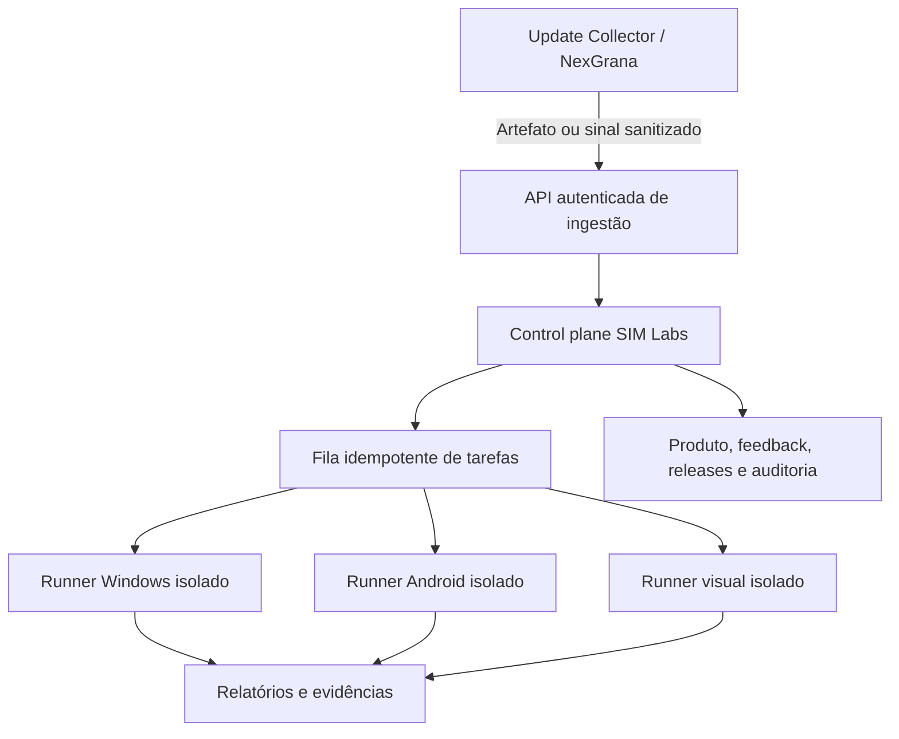

# SIM Labs — desenho operacional e estado desta entrega

## Estado atual

O material disponível contém o Update Collector para Windows e seu contrato `SIM_LABS_INGEST.json`. Não foi recebido repositório de servidor SIM Labs, configuração de hospedagem, endpoint, segredo de autenticação, banco operacional nem runner remoto. Por isso, o que esta versão implementa é um console de QA **local** acoplado ao Collector, sem upload externo e sem operação 24/7.

O console local 0.4.1 cobre ingestão manual de builds, hash, verificações estruturais, importação de feedback, execução explícita de testes de código, checklist funcional, relatórios e exclusão em lote do Collector. Ele é uma etapa utilizável do produto SIM Labs, não a central permanente descrita abaixo.

## Arquitetura proposta para o control plane

### Componentes

1. **Control plane**: API autenticada, painel web privado, catálogo do NexGrana como Produto #001, release cockpit, tasks, prioridades, relatórios e trilha de auditoria.
2. **Armazenamento**: PostgreSQL para metadados; armazenamento de objetos privado para builds e evidências; retenção, expurgo e acesso por função documentados.
3. **Fila e scheduler**: tarefas idempotentes e agendamento diário; monitoramento periódico de builds/configuração com intervalo configurável. Um worker local só roda continuamente enquanto a máquina estiver ligada e sem suspensão.
4. **Runners**: execução descartável em ambientes isolados, com rede negada por padrão, limites de CPU/memória/tempo, usuário sem privilégios, dependências fixadas e logs redigidos. Android usa emulador/dispositivo QA autorizado. Windows usa runner Windows. iOS só entra em uma fase posterior com host macOS/Xcode e assinatura configurada.
5. **Visual QA**: capturar screenshots com plataforma, versão, commit, tela, viewport e timestamp; comparar com baseline versionada e registrar diferenças para revisão humana.
6. **Agentes/setores**: separar funções (QA, UX, Produto, Segurança, Operações, Marketing e Release). Automações devem se identificar como automações; decisões de release permanecem humanas.

## Fluxo de build desejado

1. O autor associa o build a Produto, versão, commit, plataforma, canal e SHA-256.
2. A API cria um registro de ingestão e devolve URL de upload temporária, escopada e com expiração.
3. O control plane valida tamanho, tipo, assinatura/hash e política; o arquivo fica em storage privado.
4. A fila executa verificações estáticas e testes em runners isolados. Nenhum APK/EXE recebido é aberto no control plane.
5. O worker salva checks, logs sanitizados e evidências por `run_id`; falha cria task, mas não altera código nem fecha feedback.
6. QA humano testa Windows/Android, compara screenshots e decide se cada feedback foi reproduzido/corrigido.
7. Release só recebe status aprovado após gates configurados e decisão humana registrada.

## Contratos e entidades

Entidades mínimas: `product`, `release`, `artifact`, `feedback`, `task`, `run`, `evidence`, `decision` e `audit_event`.

Todo evento deve carregar `schema_version`, `product_id`, `release_id` quando aplicável, `platform`, `source`, `created_at`, `correlation_id` e `idempotency_key`. Feedback conserva o ID estável do Collector. Origem deve distinguir `internal`, `end_user_opt_in` e `automatic_signal`; não misturar relato interno com telemetria de usuário.

O app não deve enviar saldo, extrato, texto de conversa, tokens ou anexos por padrão. Sinais automáticos precisam de finalidade, minimização, consentimento quando aplicável, retenção, redaction e opção de desativar/revogar antes de conectar ao backend.

## Segurança e autorização

- Autenticação de pessoa para painel; autorização por produto/ambiente/ação com RBAC e auditoria.
- Credenciais de runner curtas, escopadas e guardadas no serviço; nunca em ZIP, app cliente, Collector ou log.
- Upload com limite, verificação de conteúdo e quarentena; não confiar em extensão.
- Código recebido só roda em sandbox real, com rede bloqueada por padrão. A confirmação da UI local não oferece isolamento.
- Logs e artefatos não devem conter chaves, JWT, segredos nem dados financeiros pessoais.
- Corrida diária gera relatório e tarefas de análise, mas não aplica correções nem fecha feedback sozinha.

## Roteiro de implementação

| Fase | Entrega | Gate |
|---|---|---|
| A — local | Console 0.4.1 do Collector, hashes, checks, feedbacks, checklist, relatórios e exclusão em lote | Testes locais do parser; inspeção manual Windows/Android continua pendente |
| B — contrato/API | Esquema versionado, autenticação, retenção, limites, trilha de auditoria e ambiente privado de QA | Threat model, testes de autorização, redaction e upload abusivo |
| C — workers | Fila, scheduler, runners descartáveis Windows/Android e resultados reproduzíveis | Rede negada, limites, limpeza de workspace e reexecução idempotente |
| D — painel | Release cockpit, feedback→task→run→decisão, evidência e relatórios diários | Acesso por função e trilha de auditoria verificadas |
| E — visual QA | Captura/comparação desktop/mobile e baseline aprovada | Screenshots por viewport, regressões reproduzíveis e revisão humana |
| F — continuidade | Worker hospedado para 24/7 e monitoramento operacional | SLA, alertas, backup/restore e custo aprovados |

## Endpoints a definir antes do upload

Não configurar endpoint fictício. O serviço futuro precisa especificar operações equivalentes a:

- `POST /api/v1/artifacts` — abrir uma ingestão autenticada e validar metadados;
- `PUT <signed-upload-url>` — enviar build para storage privado sem expor chave administrativa;
- `POST /api/v1/artifacts/{id}/finalize` — confirmar tamanho/hash e enfileirar verificações;
- `GET /api/v1/runs/{id}` — consultar andamento e resultado;
- `POST /api/v1/feedback` — registrar feedback sanitizado e com consentimento conforme origem.

Os paths são rascunhos para discussão, não endpoints implementados nem prontos para produção.
