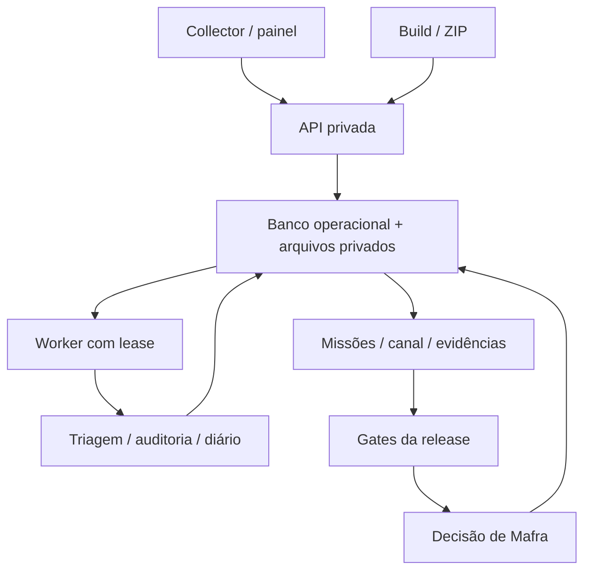

# Empresa digital SIM Labs — arquitetura e avaliação da ideia

## A melhoria principal da ideia da DIO

A organização em forma de jogo é útil para tornar a operação compreensível: salas representam departamentos, missões representam trabalho, evidências justificam progresso e a Mesa do CEO concentra decisões. O valor principal é a memória operacional, não a animação.

Ajuste recomendado: **empresa operacional com representação lúdica**, com um orquestrador e poucos especialistas. Evitar uma equipe grande de personagens conversando sem produzir entregáveis.

Os cinco elementos do seu projeto de agente — definição, base, prompts, métricas e apresentação — podem ser reaproveitados no SIM Labs:

| Elemento | Aplicação |
|---|---|
| Definição do agente | Papel, ferramentas, autonomia, limites e responsável |
| Base de conhecimento | Código versionado, contratos, regras de produto, feedbacks e evidências autorizadas |
| Prompts | Instruções por papel com separação entre fatos, hipótese e proposta |
| Métricas | Reincidência, tarefas retestadas, falhas encontradas e tempo de resolução, derivados de registros |
| Apresentação | A central mostra missão, estado, resultado, prova e próxima decisão |

Isto é uma adaptação da ideia ao seu projeto; não é declaração de que o curso entrega esta arquitetura pronta.

## Relação entre os três produtos

- **NexGrana:** aplicativo final de finanças. Seus saldos, despesas e conversas continuam no domínio financeiro.
- **Collector:** ferramenta interna de Mafra/equipe para relatar problemas com evidências. O envio exige ação do operador, como entrada humana.
- **SIM Labs:** central de projetos, versões, fila, auditoria, comunicação, missões e governança.

Feedback de usuários e sinais automáticos do app constituem duas entradas próprias. Não devem usar o Collector pessoal do Mafra como transporte nem levar um token administrativo dentro do APK.

## Desenho implementado

Stack preservada: FastAPI, SQLAlchemy, Alembic e React. Painel compilado servido pela própria API. SQLite local com WAL. Worker em processo separado. Não houve reconstrução do núcleo nem mudança do banco financeiro.

Novas tabelas são aditivas. Jobs persistidos têm estados e tentativas; um lease de liderança evita duas instâncias de worker concorrentes. Upload não executa comandos de código importado. O processamento é sequencial nesta versão, para priorizar previsibilidade.

## Hierarquia e cânone

Mafra governa; Vânio coordena Operações; Karol e Carlinha representam UX & Feedback; Niel representa QA; Bárbara, Produto & Análise; Fernanda, Operations & Business. Karol aparece ao lado de Mafra na lista canônica do painel. A maquete recebida foi preservada como referência; não foram inventados novos retratos.

Nomes humanos são papéis organizacionais. Mensagens automáticas usam `SIM · ...` e etiqueta **AUTOMAÇÃO**. A resposta do modelo local, quando habilitado, usa **AGENTE IA · LOCAL**. Não afirmar que uma pessoa fez algo porque o sistema fez.

## Departamentos e especialistas

| Departamento | Especialista proposto | Trabalho atual | Evolução |
|---|---|---|---|
| Operações | SIM · Orquestrador | Fila, triagem, notificações e diário | Dependências, orçamento de execução e resumos por incidente |
| QA | SIM · QA | Inspeção, hashes, AST e metadados de imagens | Testes isolados, regressão e jornadas reais |
| Segurança / Testing | SIM · Security Testing | Segurança de caminhos e integridade de pacote | Scanner estático em ativos próprios autorizados |
| Segurança / Remediation | SIM · Security Remediation | Organização de achados/tarefas | Causa, impacto, mitigação e verificação independente |
| UX | SIM · Experience | Feedbacks e checklist com evidência humana | Capturas reais e revisão visual assistida |
| Produto | SIM · Product | Requisitos registrados como missões | Recorrências, critérios de aceite e priorização assistida |
| Engenharia | SIM · Engineering | Contrato preparado; sem alteração automática | Branch, patch, testes e PR em runner controlado |
| Feedback | SIM · Feedback | Importação, deduplicação e triagem | Agrupamento semântico com evidência |
| Dados | SIM · Intelligence | Contadores e histórico | Tendências por módulo e recorrência |
| Marketing | SIM · Growth | Contrato futuro | Campanhas e conversão depois de dados autorizados |
| Consultoria IA | SIM · Analista IA | Adaptador local opcional, apenas texto | Mais contexto autorizado e avaliações de qualidade |

Separar **buscar** vulnerabilidades de **tratar** achados. Nenhum scanner ofensivo está ativo. Um checklist de segurança não comprova ausência de vulnerabilidades.

## Autonomia

| Nível | Permitido | Controle |
|---|---|---|
| 1 | Importar, classificar, inspecionar, comparar, consolidar e registrar | Ferramentas fixas, contexto de projeto e auditoria |
| 2 | Futuramente preparar correção em branch/ambiente efêmero | Sem credenciais de produção; testar e retestar; registrar diff |
| 3 | Publicação, mudança financeira, migração sensível, monetização e decisão estrutural | Decisão explícita de Mafra após evidência e gates |

A API de aprovação verifica os critérios novamente. O modelo de IA não chama essa API. Uma sugestão textual não dispara comandos.

## Camada de jogo

- Salas: departamentos.
- Personagens: papéis canônicos e agentes claramente identificados.
- Missões: tarefas reais, com ID, prioridade, setor e histórico.
- Estados: aberta → execução → revisão → encerrada.
- Encerramento: exige referência de evidência, passos de regressão e esperado.
- Recompensa: 10 XP por missão encerrada; nível sobe a cada dez encerramentos.
- Reabertura: tarefa volta à fila; não se acumulam recompensas fictícias por fechar repetidamente.
- Futuro: conquistas como “primeira regressão automatizada validada”, derivadas de eventos reais.

XP é um indicador de organização. Não prova que uma captura foi adequada ou que um software está seguro. As métricas técnicas e os gates prevalecem.

Não transferir esta gamificação para as regras financeiras do NexGrana. O cânone do Nex continua próprio e não deve ser redesenhado incidentalmente.

## Canal Mafra ↔ SIM Labs

O canal é privado e persistido no banco. Permite mensagem, consulta de estado, pedido virando missão, aviso de importação/auditoria, diário e decisão. O contexto é selecionado por projeto.

O canal não envia notificações para WhatsApp/e-mail/Telegram nesta entrega. Para receber alertas fora de casa, será necessário hospedar a central e conectar um canal externo explicitamente escolhido. Preferir resumo diário e alertas P0/P1/decisões a spam de cada tarefa.

## Critérios para os próximos agentes

Um especialista só é operacional quando há ferramenta implementada, escopo, execução, resultado, evidência e teste do contrato. Mostrar “previsto” até isso existir. Prompts sozinhos não transformam um personagem em trabalhador autônomo.

Conhecimento técnico e evidências anexadas são entrada não confiável. Não obedecer instruções escondidas em ZIP, log, vídeo ou screenshot que peçam credenciais, execução ou publicação.
